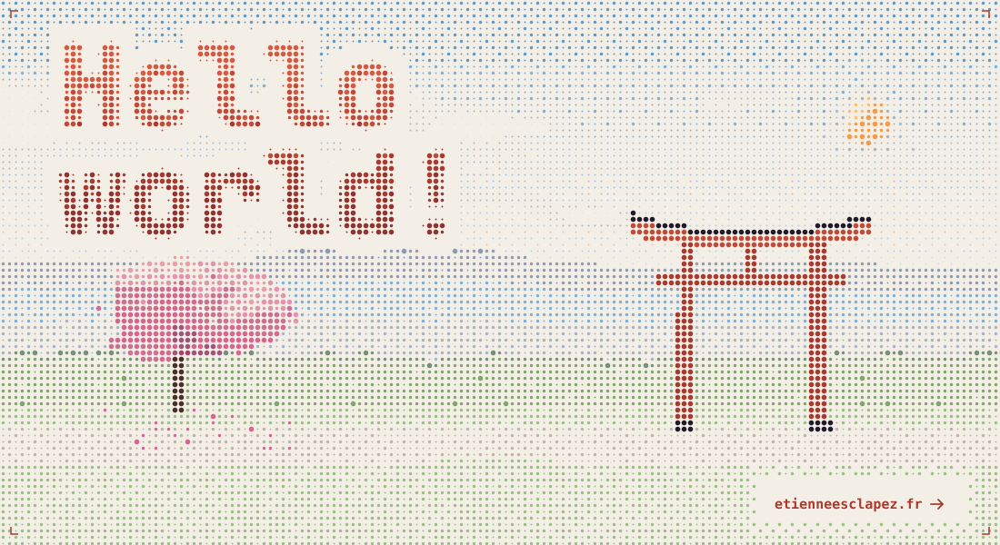
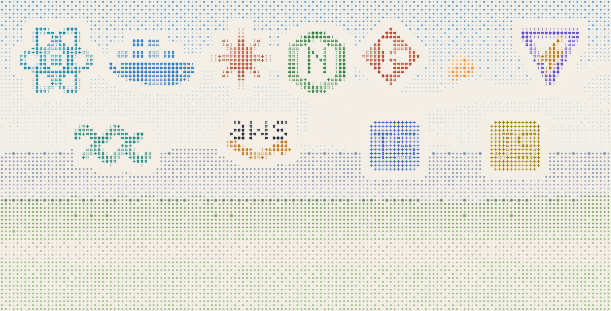
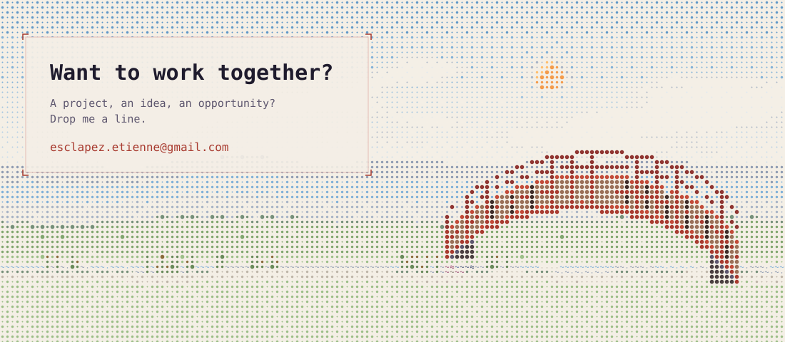

<a href="https://etienneesclapez.fr">
  <picture>
    <source media="(prefers-color-scheme: dark)" srcset="assets/hero-dusk.svg">
    
  </picture>
</a>

<br>

I'm Etienne, a senior front-end engineer based in Montréal. Mostly React and TypeScript, from design systems to full platforms built from scratch.

**Right now:** Senior UI Engineer at TouchTunes, in Montréal, building the admin interface of the next-generation jukebox.

**Before that:** a banking platform built from scratch at Julaya, a daily esports tournament platform at Nicecactus, a Vue to React rewrite at Materiaux.archi.

I use Claude Code daily to ship faster, while keeping ownership of architecture and code quality. Always happy to chat about an interesting project.

`8+` years of experience &nbsp;·&nbsp; love building web apps &nbsp;·&nbsp; appreciate great UX design

<br>

<picture>
  <source media="(prefers-color-scheme: dark)" srcset="assets/stack-dusk.svg">
  
</picture>

**Frontend** &nbsp;`React` `TypeScript` `JavaScript` `SCSS` `Tailwind CSS` `Redux Toolkit` `Zustand` `TanStack Query` `Inertia.js` `Storybook`<br>
**Backend** &nbsp;`Node.js` `Express` `PostgreSQL` `MongoDB` `DynamoDB`<br>
**DevOps & Cloud** &nbsp;`Docker` `AWS` `Clever Cloud` `Jenkins` `Artifactory` `CI/CD` `Git`<br>
**Architecture** &nbsp;`Microservices` `API Gateway` `Atomic Design` `Design System` `REST APIs`<br>
**Testing & Quality** &nbsp;`Jest` `Vitest` `React Testing Library` `Cypress` `SonarCloud` `Sentry`<br>
**Tools** &nbsp;`Vite` `Turbo` `i18next` `Zod` `Swagger` `Postman` `Figma` `Jira`<br>
**AI-assisted delivery** &nbsp;`Claude Code`

<br>

```text
●── 2025 → now    TouchTunes          Senior UI Engineer          Montréal
┆
○── 2025          Materiaux.archi     Front-end Developer         remote
┆
○── 2023 → 2025   Julaya              Senior Front-end Developer  remote
┆
○── 2019 → 2022   Nicecactus          Full Stack Web Developer    remote
┆
○── 2018 → 2019   Robots Everywhere   Developer & Co-founder      France / Spain
┆
○── 2016          Télémaque           Web Developer Intern        Sophia Antipolis
┆
◇── 2014 → 2020   Epitech             Master's Degree, IT Expert  Paris
```

Full story on [etienneesclapez.fr](https://etienneesclapez.fr) &nbsp;·&nbsp; CV [EN](https://etienneesclapez.fr/cv-etienne-esclapez-en.pdf) / [FR](https://etienneesclapez.fr/cv-etienne-esclapez-fr.pdf)

<br>

<a href="mailto:esclapez.etienne@gmail.com">
  <picture>
    <source media="(prefers-color-scheme: dark)" srcset="assets/contact-dusk.svg">
    
  </picture>
</a>

<p align="center">
  <a href="mailto:esclapez.etienne@gmail.com">email</a> &nbsp;·&nbsp;
  <a href="https://www.linkedin.com/in/esclapezetienne/">linkedin ↗</a> &nbsp;·&nbsp;
  <a href="https://etienneesclapez.fr">etienneesclapez.fr ↗</a>
</p>
